<div align="center">


# Browser Startup

**A calm, customizable new-tab dashboard for Chrome and Edge.**

Shortcuts, English–Turkish vocabulary cards, a calendar, a password generator, weather, and a Pomodoro timer, all on one page.


[](LICENSE)

[Features](#features) · [Tour](#feature-tour) · [Installation](#installation) · [Usage](#usage) · [Privacy](#privacy-and-external-connections) · [FAQ](#troubleshooting)

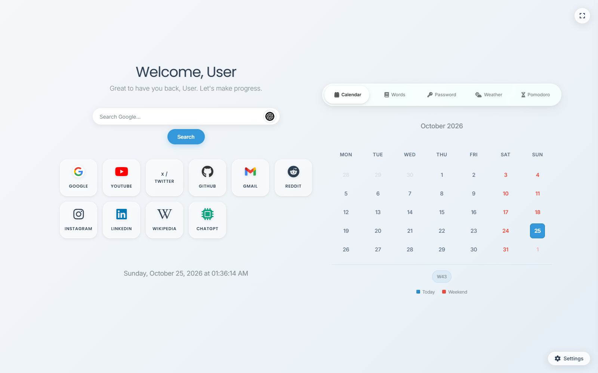

</div>

## Features

- 🔍 **Web and AI search:** search Google, or switch to AI mode to send your question to ChatGPT or Claude.
- 🔗 **Shortcuts:** add, edit, and delete links. Use Font Awesome icons, image URLs, or your own PNG, JPEG, or WebP files.
- 📚 **Vocabulary cards:** collect English words with Turkish meanings and practice them as flip cards in a shuffled order.
- 📅 **Calendar:** the current month with week numbers, today, and weekends highlighted.
- 🔐 **Password generator:** strong 4–50 character passwords from the Web Crypto API.
- 🌤️ **Weather:** current conditions and a forecast for your approximate location, with three data sources.
- ⏳ **Pomodoro timer:** configurable work and break sessions with a session counter.
- 🎨 **Four themes:** Light, Dark, Midnight, and Auto (switches with sunrise and sunset).
- 🖼️ **Custom backgrounds:** upload images, adjust blur, brightness, and contrast, and rotate between them.
- 🌐 **Two languages:** the whole interface is available in English and Turkish.
- 📐 **Fits any window:** the layout scales with the window and stacks vertically in portrait windows.
- 💾 **Backup and restore:** export everything to a single `.yay` file and import it in another browser.

No account, no backend, no analytics, and no build step: just HTML, CSS, and JavaScript.

## Feature tour

### 🔍 Search: Google or AI

Type in the search bar and press **Enter**. Click the AI logo on the right side of the bar to switch to AI mode: the bar turns orange, the button changes to **Send**, and your question opens in ChatGPT or Claude (choose which one in **Settings → Search AI**).

AI mode only opens the provider's website with your question filled in; no AI model runs inside the dashboard and no API key is needed.

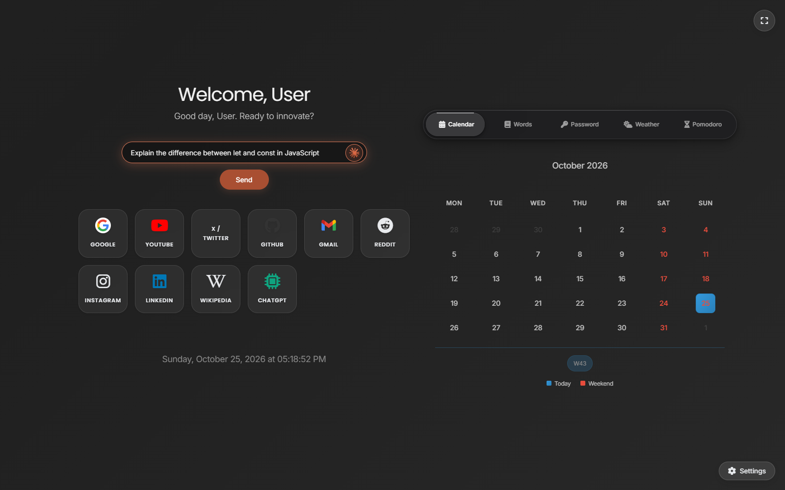

### 🔗 Shortcuts

Ten popular sites are included by default. Add your own from **Settings → Shortcuts → Add New Shortcut**, or right-click any shortcut to edit or delete it.

| Right-click menu | Shortcut editor |
| --- | --- |
| 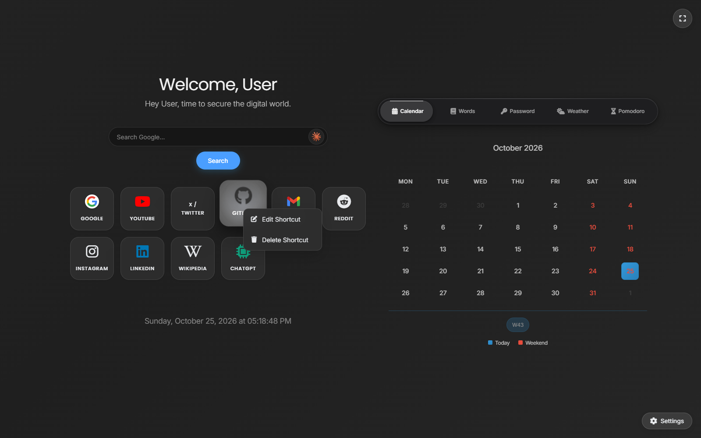 | 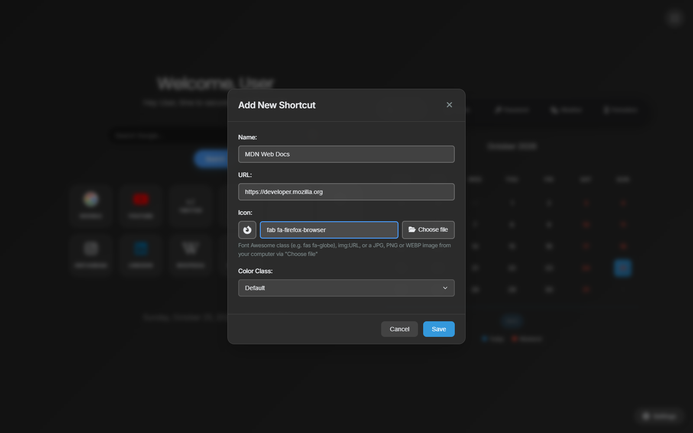 |

The **Icon** field accepts three kinds of values, and a live preview shows the result:

| Icon type | Example |
| --- | --- |
| Font Awesome class | `fas fa-star`, `fab fa-github` |
| Image URL | `img:https://example.com/logo.png` |
| Image from your computer | Click **Choose file** and pick a PNG, JPEG, or WebP file |

Uploaded images are resized to at most 128 × 128 px and stored with your shortcuts, so they keep working offline and are included in backups.

### 📚 Vocabulary cards

A personal English–Turkish word notebook that turns your words into practice cards.

| Card | Meaning revealed |
| --- | --- |
| 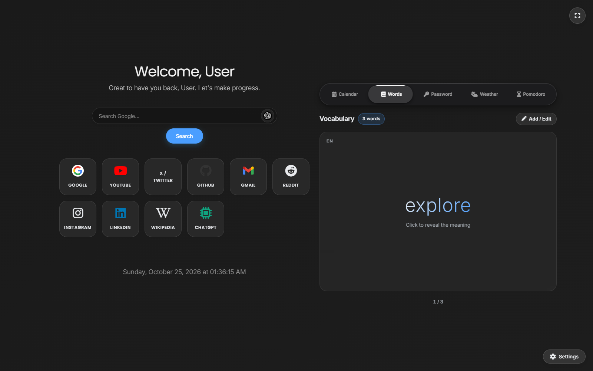 | 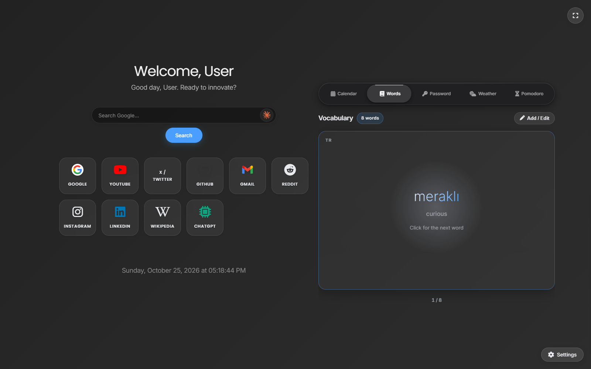 |

- **Practice:** click a card to flip it and see the meaning; click again and it fades to the next word.
- **Smart shuffle:** every word appears once per round in random order, and the same word never shows twice in a row, even across rounds. The counter under the card shows your place in the round.
- **Automatic translation:** type an English word and the Turkish meaning fills in by itself, using the browser's built-in [Translator API](https://developer.chrome.com/docs/ai/translator-api). Translation runs on your device. You can always type or correct the meaning yourself.
- **Manage your list:** click **Add / Edit** to add words, click a word in the list to edit it, or delete it with the trash button. Duplicate words are detected regardless of letter case.

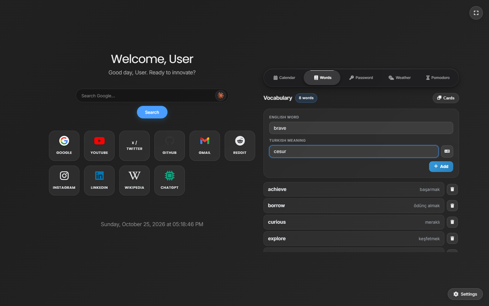

### 📅 Calendar

Shows the current month starting on Monday, with today highlighted, weekends in red, and the ISO week number below.

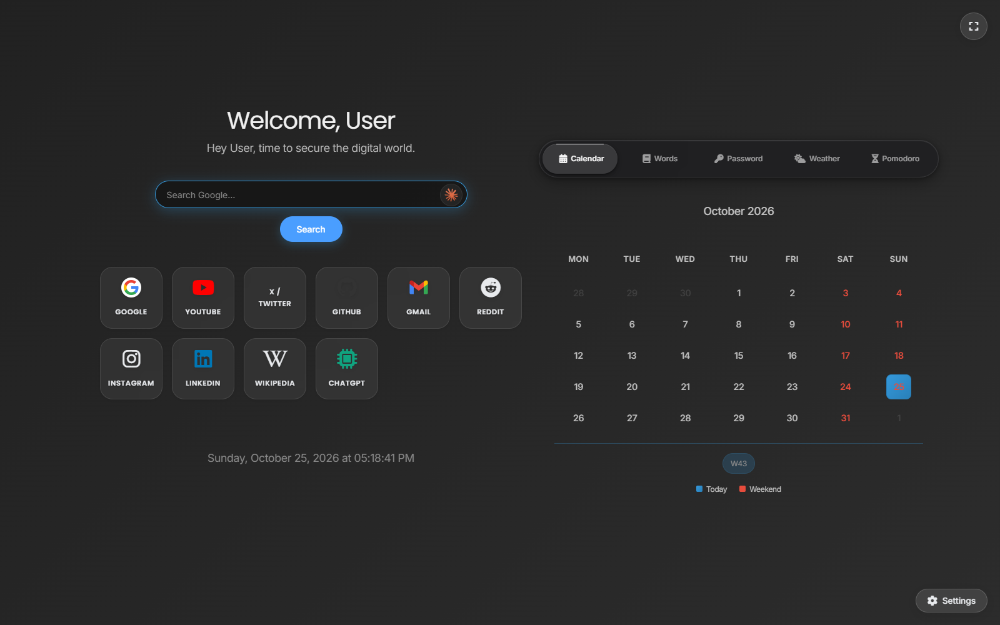

### 🔐 Password generator

Generates passwords with `crypto.getRandomValues`, never `Math.random`.

- Length from 4 to 50 characters
- Numbers, uppercase, lowercase, and special characters can each be turned on or off
- Optionally excludes look-alike characters such as `0`, `O`, `1`, `l`, and `I`
- Strength meter and one-click copy
- **Ctrl+G** creates a new password while the widget is open

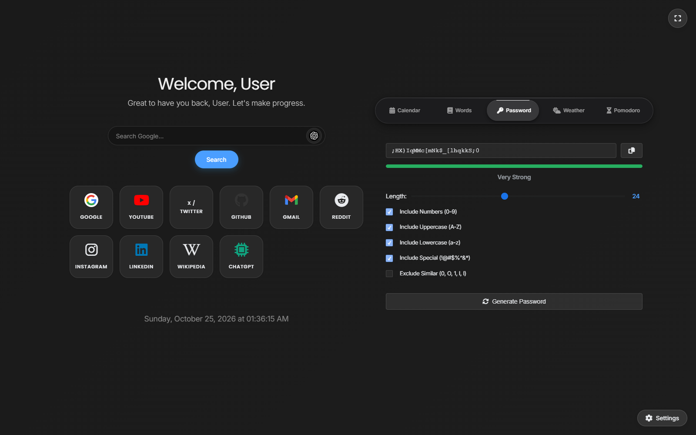

### 🌤️ Weather

Shows temperature, feels-like temperature, conditions, humidity, wind, pressure, visibility, and a forecast for your approximate location (found from your IP address).

Without any setup, it uses [Open-Meteo](https://open-meteo.com/) and falls back to [wttr.in](https://wttr.in/). For more detail, get a free key from [WeatherAPI.com](https://www.weatherapi.com/) and paste it into **Settings → Weather API Key**. Results are cached to avoid repeated requests.

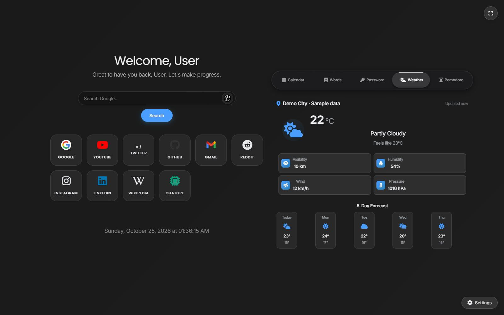

### ⏳ Pomodoro timer

Work and break sessions with start, pause/resume, and skip controls, a progress bar, and a completed-session counter. The defaults are 25 and 5 minutes; change them in **Settings → Pomodoro** (work 1–180, break 1–120 minutes).

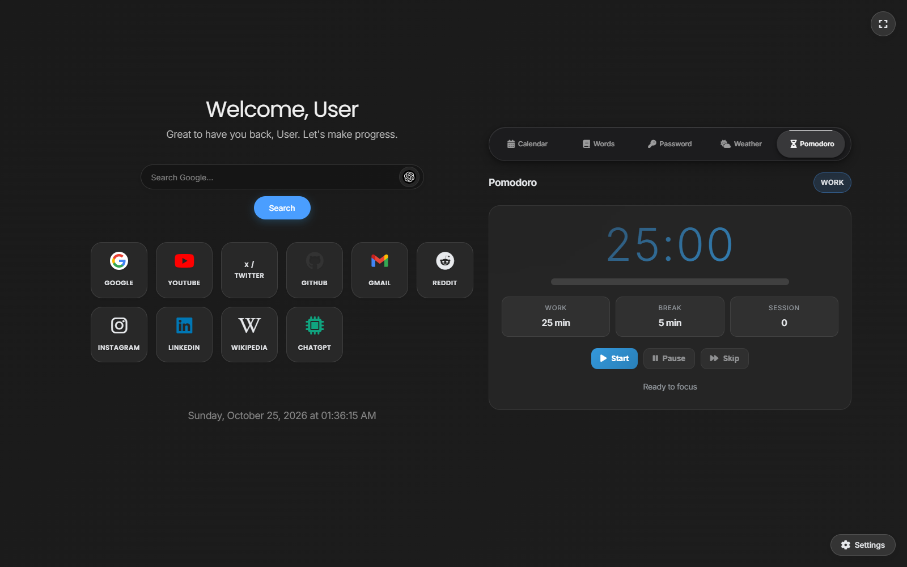

### 🎨 Themes

Pick **Light**, **Dark**, or **Midnight**, or choose **Auto** to switch between light and dark at your local sunrise and sunset.

| Dark | Midnight |
| --- | --- |
| 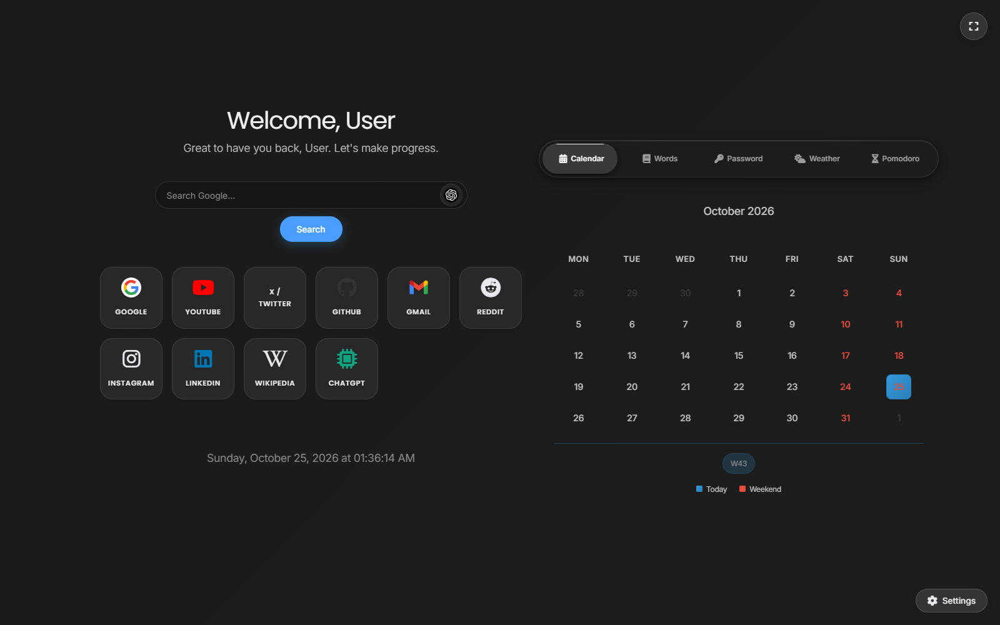 | 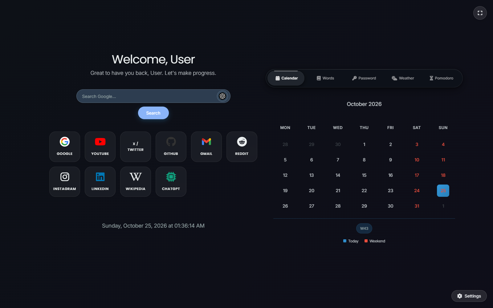 |

### 🖼️ Custom backgrounds

In **Settings → Background**, choose **Upload Images** to use your own photos. You can upload several, adjust blur (0–60 px), brightness, and contrast (0–200%), and rotate through them every 1–60 minutes. Images are stored in the browser's IndexedDB.

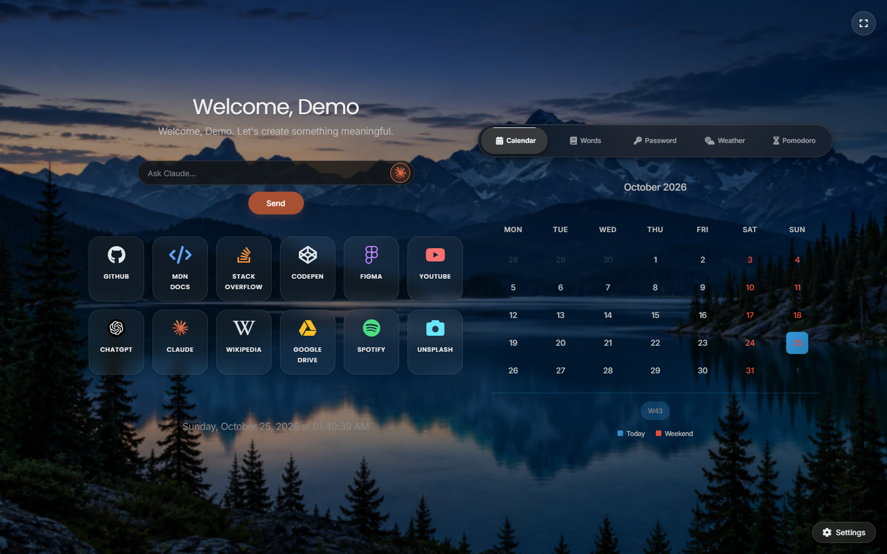

<details>
<summary><b>More background examples</b></summary>

<br>

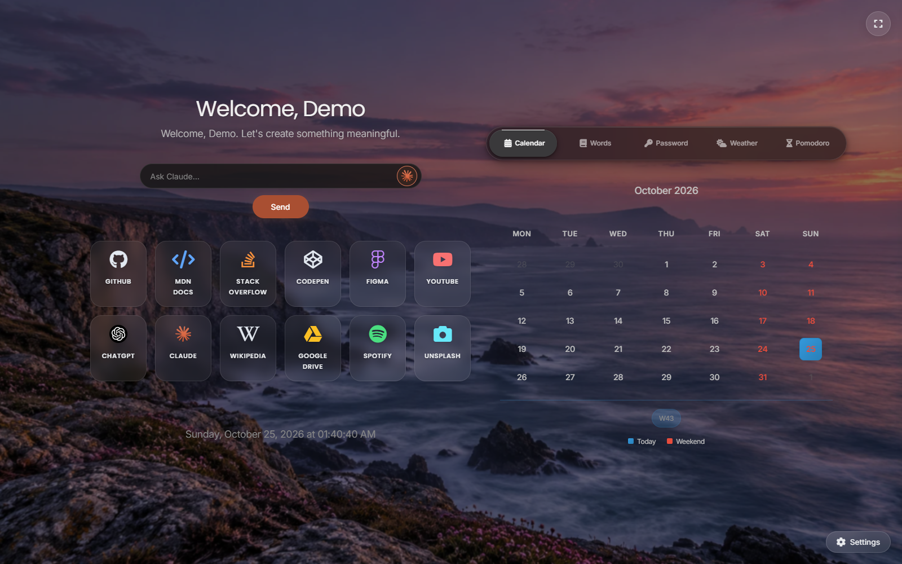

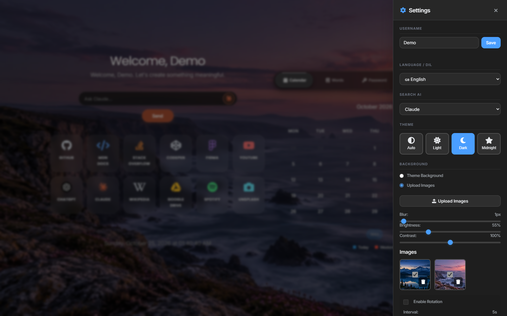

Want to try them? Download [Alpine lake](screenshots/backgrounds/alpine-lake.webp) or [Coastal dusk](screenshots/backgrounds/coastal-dusk.webp) and upload them in **Settings → Background → Upload Images**. Both images are AI-generated; their [prompts](screenshots/backgrounds/prompts.json) are included.

</details>

### 🌐 English and Türkçe

Switch the entire interface, including dates, greetings, and messages, between English and Turkish in **Settings → Language / Dil**.

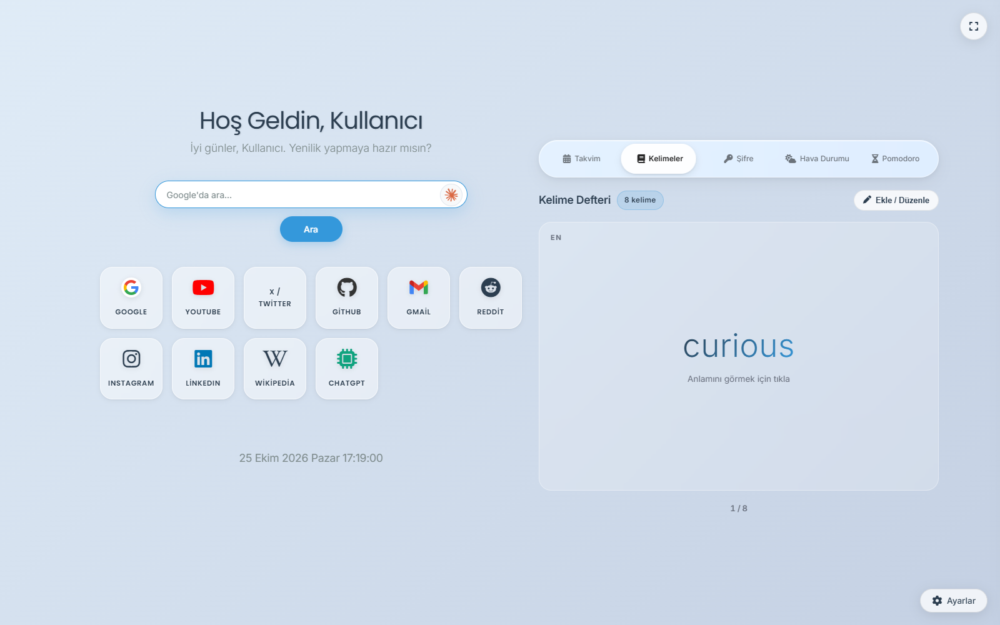

### 📐 Fits any window

The two-column layout scales down smoothly when the window gets smaller, so nothing overlaps or gets cut off. When the window is taller than it is wide (for example on a vertical monitor or a half-screen window), the panels stack on top of each other instead of shrinking.

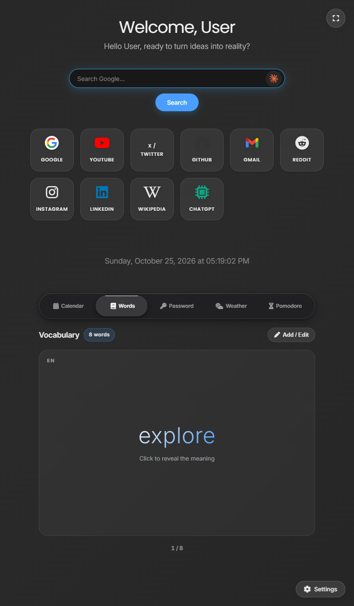

### ⚙️ Settings and backup

Open **Settings** from the bottom-right corner to change your name, language, AI provider, theme, background, Pomodoro durations, and weather API key.

| Settings | Data management |
| --- | --- |
| 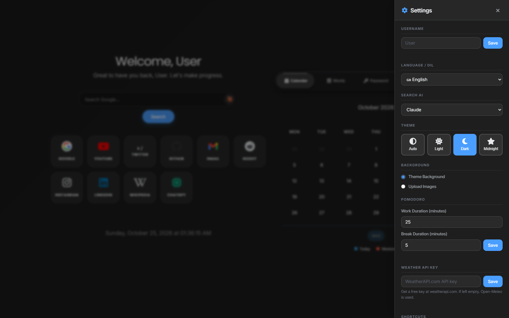 | 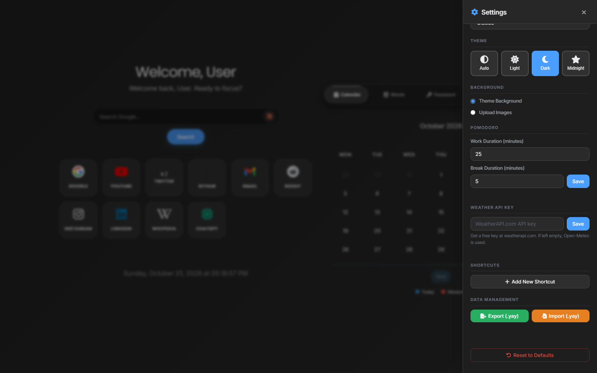 |

- **Export (.yay)** saves your settings, shortcuts, vocabulary, and backgrounds to one file.
- **Import (.yay)** restores them, for example in another browser or on another computer.
- **Reset to Defaults** restores the default shortcuts, theme, and settings and clears your vocabulary (after a confirmation).

## Installation

1. Clone the repository, or download it as a ZIP and extract it:

   ```bash
   git clone https://github.com/ByYay/BrowserStartup.git
   ```

2. Open `chrome://extensions` (Chrome) or `edge://extensions` (Edge).
3. Turn on **Developer mode** and click **Load unpacked**.
4. Select the `BrowserStartup` folder (the one containing `manifest.json`).
5. Open a new tab. 🎉

There is nothing to install or build. To update, pull the latest changes (or download the ZIP again) and click the reload button on the extension card.

> [!NOTE]
> Chrome may ask whether to keep the new-tab page changed by the extension. Choose **Keep it**.

### Enabling automatic translation

Automatic word translation uses Chrome's built-in Translator API, available in **desktop Chrome 138 or newer**. The first time you translate, Chrome downloads the English–Turkish language pack (the status line shows the progress); after that, translation works offline. In browsers without the API, simply type meanings yourself.

## Usage

| Task | How |
| --- | --- |
| Search | Type and press **Enter**. **Shift+Enter** adds a new line. |
| Toggle AI mode | Click the AI logo in the search bar. |
| Choose the AI provider | **Settings → Search AI** |
| Add a shortcut | **Settings → Shortcuts → Add New Shortcut** |
| Edit or delete a shortcut | Right-click it. |
| Use your own icon | In the shortcut editor, click **Choose file**. |
| Add a word | **Words** tab → **Add / Edit**, type the word, press **Enter**. |
| Edit a word | Click it in the word list; press **Escape** to cancel. |
| Practice words | Click the card to flip it, click again for the next word. |
| Switch widgets | Click a tab, or use **←** / **→**, **Home**, and **End** on the tab bar. |
| New password | **Ctrl+G** while the Password widget is open. |
| Fullscreen | The button in the top-right corner. |
| Close a dialog or settings | **Escape** |
| Back up / restore | **Settings → Data Management** |

## Privacy and external connections

Browser Startup has no backend, account, or analytics. Your preferences, shortcuts, and vocabulary stay in the browser's `localStorage`; backgrounds are stored in IndexedDB. Nothing is uploaded anywhere.

Some features do need the network:

| Service | Used for |
| --- | --- |
| Google Fonts, cdnjs (Font Awesome) | Fonts and icons, loaded when the page opens. |
| Shortcut icon hosts | Default Google and Gmail icons, and any image URLs you add. Uploaded icons stay local. |
| ipapi.co / ipwho.is | Approximate location for weather and the Auto theme. |
| sunrise-sunset.org | Sunrise and sunset times for the Auto theme. |
| WeatherAPI.com, Open-Meteo, wttr.in | Weather for your location. Your API key, if set, goes only to WeatherAPI.com. |
| Google, ChatGPT, Claude | Your search text, only when you submit a search. |
| Browser Translator | May download a language pack once; translation itself runs on your device. |

> [!WARNING]
> **Backups are not encrypted.** A `.yay` file is Base64-encoded JSON that contains your weather API key, name, shortcuts, uploaded icons, vocabulary, and backgrounds. Keep it private and never commit it; this repository's `.gitignore` already excludes `*.yay`.

## Troubleshooting

<details>
<summary><b>Automatic translation doesn't work</b></summary>

The Translator API is only in desktop Chrome 138 and newer; Edge and other browsers don't have it yet. On Chrome, make sure you have enough free disk space for the language pack and try the translate button next to the meaning field. You can always type the meaning manually.

</details>

<details>
<summary><b>Weather says it can't find my location</b></summary>

Location comes from your IP address. VPNs, ad blockers, or privacy extensions that block ipapi.co and ipwho.is will prevent it. Allow those domains or disable the blocker for the new-tab page.

</details>

<details>
<summary><b>My settings disappeared after reinstalling</b></summary>

Data is stored per extension. Removing the extension (or loading it from a different folder) creates a new, empty storage. Export a `.yay` backup before reinstalling and import it afterwards.

</details>

<details>
<summary><b>A shortcut icon doesn't load</b></summary>

Some sites block their images from being shown on other pages. Download the logo and use **Choose file** instead; uploaded icons are stored locally and always load.

</details>

## How it works

The page is a plain Manifest V3 extension that replaces the new-tab page (`chrome_url_overrides.newtab`). It follows the extension content security policy: there are no inline scripts or event handlers. Instead, buttons carry `data-action` attributes, and `app.js` routes each click to the matching function.

```text
BrowserStartup/
├── assets/ai-logos/      # ChatGPT and Claude logos for the search bar
├── css/                  # Styles per feature, plus themes
├── icons/                # Extension icons (16, 32, 48, 128 px)
├── js/
│   ├── app.js            # Start-up and delegated UI actions
│   ├── scale.js          # Window scaling and portrait layout
│   ├── search.js         # Google and AI search
│   ├── shortcuts.js      # Shortcut editor and uploaded icons
│   ├── vocab.js          # Vocabulary storage, practice, and translation
│   ├── calendar.js       # Calendar and date/time
│   ├── password.js       # Password generator
│   ├── weather.js        # Location, weather providers, and caching
│   ├── clock.js          # Pomodoro timer
│   ├── widgets.js        # Widget tabs and keyboard navigation
│   ├── themes.js         # Themes and sunrise/sunset logic
│   ├── background.js     # Background storage, filters, and rotation
│   ├── settings.js       # Preferences, backup, restore, and reset
│   └── translations.js   # English and Turkish UI text
├── screenshots/          # README images
├── index.html
└── manifest.json
```

### Development

Edit the files and reload the extension from `chrome://extensions` (or simply open a new tab for HTML/CSS changes). You can also preview the page without installing it by serving the folder locally:

```bash
python -m http.server 8000
```

Then open `http://localhost:8000`. Note that a local preview and the installed extension keep separate data.

To add a new interface text, add the key to both the `tr` and `en` objects in `js/translations.js` and mark the element with `data-tr="your-key"`.

## Contributing

Issues and pull requests are welcome. Please keep the project dependency-free and test your change both as an installed extension and in both languages.

## License

[MIT](LICENSE) © 2026 ByYay

Third-party names, logos, fonts, and icons belong to their respective owners and remain subject to their own terms.

<sub>Screenshots were taken in a fresh browser profile with a demo name, the default shortcuts, and example words. The weather screenshot uses sample data.</sub>
